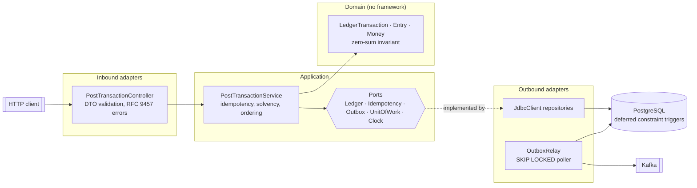
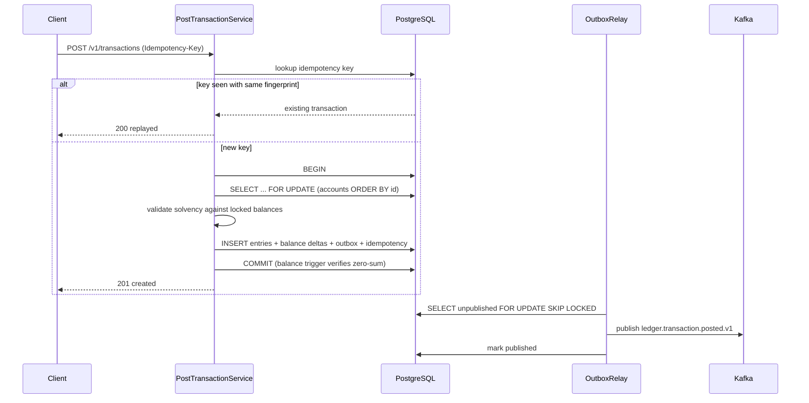

# ledger-core

A double-entry ledger service in Kotlin and Spring Boot, built around one requirement:
**money must never be recorded incorrectly, including under concurrency and retries.**

Most reference backends are CRUD with authentication. This one is deliberately narrow
and deep — it exists to demonstrate correctness engineering: idempotency bound to
payloads, pessimistic locking with a global lock order, invariants enforced in the
database rather than only in application code, and a transactional outbox.

[](https://github.com/dev-danilocordeiro/ledger-core/actions/workflows/ci.yml)

---

## Architecture

Hexagonal, with the domain free of framework imports.



### Posting flow

Order is load-bearing. Reading a balance before acquiring the lock makes the overdraft
check unreliable; writing the idempotency record before the entries makes a crashed
request look like a completed one.



---

## Design decisions

| Decision | Why | What it costs |
|---|---|---|
| `Long` minor units, not `BigDecimal` | One canonical representation. BigDecimal scale drifts across JDBC drivers and JSON parsers, producing rounding errors that only surface at reconciliation. | Currencies with non-decimal subdivisions need explicit handling. |
| Pessimistic `FOR UPDATE`, ordered by account id | Overdraft checks must read a balance nobody else can change. Global lock order makes deadlocks structurally impossible. | Throughput per account is serialised. Fine for wallets; would need sharding for a hot clearing account. |
| Invariants duplicated in Postgres | A rule that lives only in Kotlin is bypassed by any migration, psql session or future service. | Two places to change. Mitigated by ADR-gating the invariants. |
| Transactional outbox, polled | Event published if and only if money moved, with no XA and no dual-write. | ~500 ms publish latency; at-least-once delivery. Debezium CDC would cut latency at the cost of Kafka Connect plus a replication slot. |
| Idempotency key bound to a payload fingerprint | A bare key lets a client reuse it for a different transfer and receive success for an operation that never happened. | Callers must send byte-stable payloads, or sort as this service does. |
| Virtual threads, not coroutines | The workload is JDBC holding row locks; a lock lives with the connection for the length of the transaction. Loom gives the scalability without rewriting persistence onto R2DBC. | No structured concurrency in the request path. |
| `JdbcClient`, not JPA | Explicit SQL, no lazy loading, no identity map deciding when a write happens. Locking semantics are visible in the query. | More mapping code. |

Full write-ups in [`docs/adr/`](docs/adr).

---

## Quickstart

Docker is the only prerequisite.

```bash
git clone https://github.com/dev-danilocordeiro/ledger-core.git
cd ledger-core
docker compose up --build
```

Create two accounts and move money:

```bash
# Accounts are seeded through SQL for now; an admin API is out of scope.
docker compose exec postgres psql -U ledger -d ledger -c "
  INSERT INTO account (id, currency, normal_side, allows_negative) VALUES
    ('11111111-1111-1111-1111-111111111111', 'BRL', 1, false),
    ('22222222-2222-2222-2222-222222222222', 'BRL', 1, true);"

curl -sS -X POST http://localhost:8080/v1/transactions \
  -H 'Content-Type: application/json' \
  -H 'Idempotency-Key: demo-transfer-0001' \
  -d '{
        "currency": "BRL",
        "entries": [
          {"accountId":"22222222-2222-2222-2222-222222222222","direction":"CREDIT","amountMinorUnits":10000},
          {"accountId":"11111111-1111-1111-1111-111111111111","direction":"DEBIT","amountMinorUnits":10000}
        ],
        "externalReference": "order-42"
      }' | jq
```

Repeat the same command: the response is `200` with `"replayed": true` and no second
transaction. Change the amount while keeping the key: `409 idempotency-conflict`.

---

## Configuration

| Variable | Default | Description |
|---|---|---|
| `DB_URL` | `jdbc:postgresql://localhost:5432/ledger` | JDBC URL |
| `DB_USER` | `ledger` | Database user |
| `DB_PASSWORD` | `ledger` | Database password |
| `DB_POOL_SIZE` | `20` | Hikari maximum pool size |
| `KAFKA_BOOTSTRAP_SERVERS` | `localhost:9092` | Kafka bootstrap servers |
| `OUTBOX_TOPIC` | `ledger.transactions` | Topic for posted-transaction events |
| `OUTBOX_BATCH_SIZE` | `100` | Rows claimed per relay poll |
| `OUTBOX_POLL_INTERVAL_MS` | `500` | Relay poll interval |
| `LOG_LEVEL` | `INFO` | Log level for `dev.danilocordeiro.ledger` |

---

## Observability

- `GET /actuator/health` — liveness and readiness probes enabled.
- `GET /actuator/prometheus` — Micrometer metrics, including `ledger_outbox_published`
  and `ledger_outbox_publish_failed`.
- Logs are JSON on stdout via Logstash encoder, with `transaction_id` on every posting
  so a single money movement is traceable end to end.
- Prometheus is wired in `docker-compose.yml` and scrapes the service on startup.

---

## Testing

```bash
./gradlew test
```

| Layer | Tooling | What it proves |
|---|---|---|
| Domain | JUnit 5 | Zero-sum, positive amounts, normal-side balance semantics |
| Application | JUnit 5 + MockK | Idempotency replay, fingerprint conflict, solvency, currency match |
| Integration | Testcontainers (Postgres + Kafka) | Concurrency, deadlock freedom, database-level invariants |

The tests that matter are in `ConcurrentPostingIT`:

- 200 concurrent R$1.00 debits against a R$100.00 balance — exactly 100 succeed, final
  balance is zero, and the entry log still sums to zero globally.
- 32 concurrent requests sharing one idempotency key — exactly one transaction exists
  and every caller sees the same id.
- 100 opposing transfers between the same two accounts — zero failures, which is what
  the global lock order buys.

`DatabaseInvariantIT` writes raw SQL that bypasses the application entirely, to confirm
Postgres rejects an unbalanced commit and a forbidden negative balance on its own.

---

## API

`POST /v1/transactions`, `Idempotency-Key` header required.

| Status | Meaning |
|---|---|
| `201` | Transaction posted |
| `200` | Identical request replayed; no new transaction |
| `400` | Malformed payload |
| `404` | `account-not-found` |
| `409` | `idempotency-conflict` — key reused with a different payload |
| `422` | `unbalanced-transaction`, `insufficient-funds`, `currency-mismatch` |

Errors follow RFC 9457 problem details with a stable `type` URI per failure mode.

---

## Roadmap

- [ ] OpenAPI contract published from the controller, with schema linting in CI
- [ ] Reversal endpoint (compensating transaction, never a delete)
- [ ] Balance snapshot table to bound `SUM(entries)` reconstruction cost
- [ ] k6 load profile and a published latency report
- [ ] `ledger-recon` — Go service consuming `ledger.transactions` and reconciling
      against bank return files
